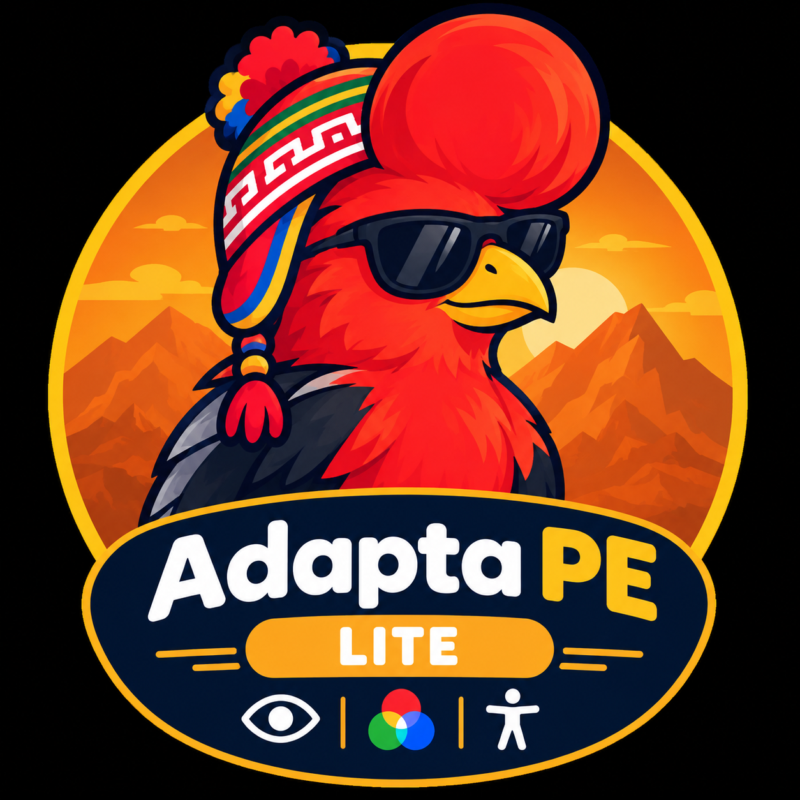
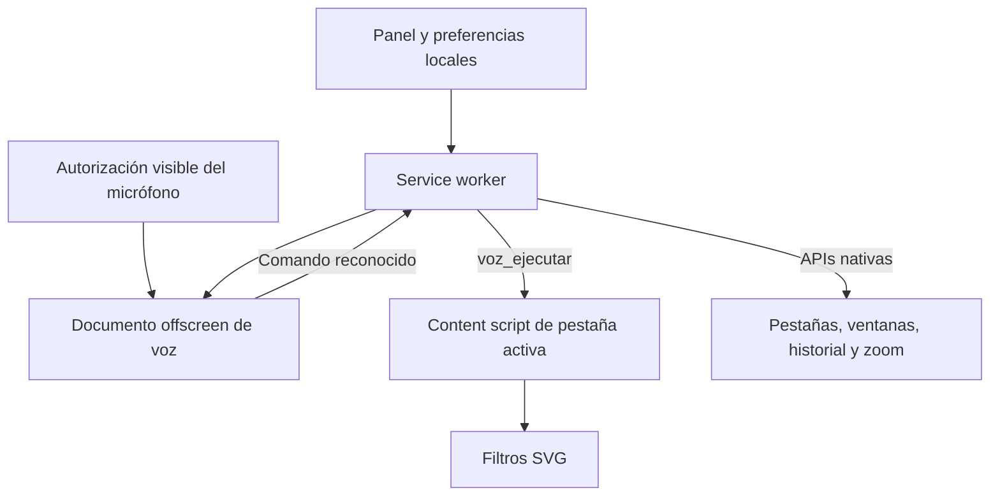

<p align="center">
  
</p>

# 🇵🇪 AdaptaPE Lite — Asistencia de voz y filtros de color

> **Versión del código:** 3.0 · Manifest V3.
> **Requisito mínimo del manifest:** Chromium 119 o posterior.
> **Navegadores objetivo:** Google Chrome y derivados Chromium, como Edge y Brave; la voz requiere una API de reconocimiento disponible.
> **Sitio oficial:** [adaptape.thealejo-dev.cc](https://adaptape.thealejo-dev.cc).
> **Código fuente:** [TheAlejo160/Adapta-PE-Lite](https://github.com/TheAlejo160/Adapta-PE-Lite).

## Contenido

- [Qué es AdaptaPE Lite](#qué-es-adaptape-lite)
- [A quién está dirigida](#a-quién-está-dirigida)
- [Cómo funciona en el uso diario](#cómo-funciona-en-el-uso-diario)
- [Descarga e instalación](#descarga-e-instalación)
- [Primer uso](#primer-uso)
- [Usos y ejemplos](#usos-y-ejemplos)
- [Nueva pestaña de AdaptaPE](#nueva-pestaña-de-adaptape)
- [Comandos de voz](#comandos-de-voz)
- [Idioma de la extensión y de voz](#idioma-de-la-extensión-y-de-voz)
- [Filtros de color](#filtros-de-color)
- [Mascotas](#mascotas)
- [Arquitectura y código](#arquitectura-y-código)
- [Backend Python opcional](#backend-python-opcional-estado-real)
- [Privacidad y alcance](#privacidad-y-alcance)
- [Actualizaciones y solución de problemas](#actualizaciones-y-solución-de-problemas)
- [Desarrollo y comprobaciones](#desarrollo-y-comprobaciones)
- [Autoría, licencia y uso de IA](#autoría-licencia-y-uso-de-ia)

## Mascotas

Lite 3.0 permite elegir **Tinku** (gallito de las rocas), **Cuchu** (cuy) o **Yati** (llama) en «Tu mascota», o dejar «Sin mascota».

Aparece abajo a la derecha en cada web permitida y sigue el cursor. Arrastra su nombre o enfócalo con Tab y usa las flechas para moverla. La ubicación se guarda entre páginas y se adapta a la ventana. Chrome bloquea esta interfaz en sus páginas internas y la tienda.

Con Voz activada, di «Computadora» y después «mascota Tinku», «mascota Cuchu» o «mascota Yati». También puedes decir «saluda mascota», «duerme mascota», «despierta mascota» y «oculta mascota». Reacciona a la espera de comandos, errores y respuestas habladas. La lectura con TalkBack y el cursor cinético siguen siendo exclusivos de Base.

Los nombres toleran separaciones y letras repetidas, como «Y Atti», «Ya ti», «Tin cu» y «Cu chu», además de variantes acotadas como Tincu, Tinko, Kuchu, Cucho, Yaty y Yate. Sólo se corrigen dentro de la orden para elegir mascota; búsquedas y dictado conservan su texto. El indicador conserva su estado al abrir el panel, y mascota, indicador y filtros se recuperan si una web sustituye su contenido al navegar.

Al actualizar la extensión instalada como carpeta, recárgala una vez en `chrome://extensions` para que Chrome lea los archivos y permisos nuevos. Las pestañas web se reconectan automáticamente; los recursos de mascotas están declarados en el manifest. Lite no carga MediaPipe ni cámara.

Usa WebP locales con transparencia y codificación sin pérdida. Cada pestaña visible carga sólo la elegida; al perder prioridad pausa su animación y conserva la imagen, incluso al cambiar ayudas o abrir el panel. Las pestañas ocultas liberan sprites y los recuperan al volver, sin recargar. Respeta «reducir movimiento» del sistema. Sólo se guardan nombre y ubicación. Reutiliza el motor de Mascota-Modular-Adapta-PE, sin dependencias externas.

## Qué es AdaptaPE Lite

**AdaptaPE Lite** es una extensión centrada en **asistencia de voz y filtros de color**. Conserva íntegros esos módulos: permite abrir sitios, buscar, gestionar pestañas y ventanas, dictar en campos, resaltar elementos y activarlos por su nombre.

| Función de Lite | Uso |
| --- | --- |
| Voz global | Dar órdenes al navegar entre webs, pestañas y ventanas, en español, inglés, portugués, alemán, francés o italiano. |
| Búsquedas y aperturas | Acceder a sitios del catálogo o a un dominio explícito. |
| Dictado y formularios | Enfocar campos e introducir o enviar texto. |
| Selección y clic por voz | Identificar un elemento, resaltarlo y confirmar su activación. |
| Siete filtros de color | Cambiar la presentación visual y conservarla entre webs permitidas. |

Lite se instala de manera independiente. Si también utilizas [AdaptaPE Base](https://github.com/TheAlejo160/Adapta-PE), **activa Voz sólo en una variante** para evitar dos reconocedores simultáneos. Sus preferencias y permisos son independientes.

## A quién está dirigida

- Personas que quieren adaptar la presentación de colores a su percepción o comodidad visual.
- Personas que prefieren navegar, buscar o dictar por voz y reducir el uso repetido del teclado y ratón.
- Estudiantes, profesionales y público general que buscan esas funciones en una extensión centrada en voz y filtros.

La voz debe poder ser reconocida por el navegador y los elementos deben tener nombres o etiquetas que la extensión pueda localizar. Los filtros son transformaciones visuales fijas, no una corrección personalizada ni un diagnóstico.

## Cómo funciona en el uso diario

Activa Voz, concede el permiso de micrófono de la extensión y utiliza «Computadora» seguida de una orden. La escucha permanece al cambiar de pestaña o ventana; cada frase se dirige a una sola página de destino. En Nueva pestaña puedes abrir sitios, buscar y gestionar las pestañas y ventanas mediante las operaciones nativas disponibles.

Elige el filtro de color en el panel. La preferencia se aplica a las webs permitidas, incluidas las ya abiertas y las pestañas de fondo. La extensión recupera sus controladores sin pedirte que recargues cada web. Si desactivas o desinstalas la extensión, los filtros y el indicador se retiran de las pestañas abiertas al volver a mostrarlas o cuando la web cambia su contenido, también sin recargar. Al volver a una página desde el historial (bfcache), descongelar una pestaña o mostrar una página precargada, el controlador vuelve a leer las preferencias y el estado de voz. Si Chrome protege una página, los filtros y las acciones sobre elementos de esa página no pueden aplicarse allí.

## Descarga e instalación

### Desde el repositorio: ZIP o Git

**Descarga ZIP:** abre [el repositorio de AdaptaPE Lite](https://github.com/TheAlejo160/Adapta-PE-Lite), selecciona **Code → Download ZIP** y extrae el archivo en una carpeta permanente.

**Con Git:**

```bash
git clone https://github.com/TheAlejo160/Adapta-PE-Lite.git
```

No necesitas compilar, ejecutar `npm install` ni iniciar Python. Selecciona siempre **la carpeta que contiene directamente `manifest.json`**, no el ZIP ni una carpeta superior: normalmente `Adapta-PE-Lite` al clonar o `Adapta-PE-Lite-main` al extraer. En un entorno con ambas variantes puede llamarse `extensiónLite`.

1. Abre `chrome://extensions/` en Chrome.
2. Activa **Modo de desarrollador**.
3. Pulsa **Cargar descomprimida** y selecciona esa carpeta.
4. Comprueba que aparezca **AdaptaPE Lite** habilitada y fija su icono en la barra de herramientas.
5. Se abre la página de bienvenida de AdaptaPE Lite. Las webs ya abiertas reciben los scripts automáticamente, sin recargarlas.

En Edge o Brave utiliza su página de extensiones equivalente. El soporte de reconocimiento de voz puede variar entre navegadores. No elimines ni muevas la carpeta mientras la instalación descomprimida la utilice.

### Preparación desde terminal

```sh
git clone https://github.com/TheAlejo160/Adapta-PE-Lite.git
cd Adapta-PE-Lite
```

En macOS, `open -a "Google Chrome" 'chrome://extensions/'` abre el administrador. En PowerShell de Windows puedes usar `Start-Process 'chrome.exe' 'chrome://extensions/'` si Chrome está disponible en PATH; si no, abre esa página desde Chrome. Activa Modo de desarrollador y **Cargar descomprimida** con la carpeta recién clonada. Esta confirmación pertenece al navegador: clonar desde terminal no registra automáticamente la extensión.

No hay un comando `npm install` ni una compilación para usarla. Conserva los archivos del manifest, voz, catálogo, clases, iconos y licencias. Para actualizar las fuentes sin reescribir tus cambios, usa `git pull --ff-only` y recarga una vez la extensión.

## Primer uso

Al instalar la extensión se abre una **página de bienvenida** (`bienvenida.html`) con el interruptor de **Control por voz**. Sólo guarda la preferencia cuando lo pulsas; el permiso de micrófono se pide con el flujo habitual. Filtros, idioma y mascota se eligen en el panel.

El panel muestra iconos con nombres: **Control por voz** para dar órdenes y **Filtros de color**, identificado con RGB, para ajustar la presentación. Los estados **Activado / Desactivado** y el aviso de guardado muestran qué cambió. Los ejemplos se despliegan cuando los necesitas; **Configurar micrófono** está disponible también con la voz apagada. Los ajustes se guardan automáticamente.

1. Fija el icono de la extensión desde el menú de extensiones de Chrome y abre su panel.
2. Activa **Control por voz**. Si falta autorización, se abrirá una página de la extensión: pulsa **Permitir micrófono** y acepta el permiso del navegador. También puedes abrirla con **Configurar micrófono** en el panel.
3. **Idioma** sigue Chrome automáticamente y traduce toda la extensión. Puedes elegir otro en el panel (ver [Idioma de la extensión y de voz](#idioma-de-la-extensión-y-de-voz)). Los ejemplos siguientes corresponden a español. Di **«Computadora, abre YouTube»**. También puedes decir sólo **«Computadora»**, esperar el pitido y dar el comando dentro de los siguientes **8 segundos**.
4. Repite «Computadora» para cada nueva orden. Prueba «Computadora, busca accesibilidad en Wikipedia» o «Computadora, siguiente pestaña».
5. Para dictar, abre una web con un formulario, di «Computadora, enfoca correo» y después «Computadora, escribe Hola Perú». El campo debe ser visible y editable; su etiqueta o nombre debe coincidir con el que pronuncias.
6. Elige un filtro en el panel si lo necesitas. **Sin filtro** o **Quitar filtro** restablece la presentación sin el filtro de AdaptaPE.

La escucha continúa al navegar, cambiar de pestaña o ventana y usar Nueva pestaña. En las webs, un indicador muestra el estado; en páginas protegidas puedes consultarlo desde el panel. **Desactivar Voz libera el micrófono y cierra el documento central de escucha de Lite.** El permiso pertenece a la extensión, no a cada sitio; una instalación diferente puede requerir su propia autorización.

La configuración inicial requiere abrir el panel y aceptar los permisos del navegador. Los comandos permiten después controlar las acciones admitidas del navegador y de la página.

## Usos y ejemplos

| Necesidad | Cómo utilizar la extensión |
| --- | --- |
| Investigar o estudiar | «Computadora, abre Wikipedia» y «Computadora, busca accesibilidad en Wikipedia». |
| Navegar entre tareas | «Computadora, abre Gmail en una nueva pestaña» y «Computadora, siguiente pestaña». |
| Completar un formulario | «Computadora, enfoca correo», «Computadora, escribe mi dirección» y, al terminar, «Computadora, enviar formulario». |
| Elegir un elemento de una tienda | «Computadora, selecciona zapatos azules», revisar el resaltado y después «Computadora, dale clic». |
| Ajustar la presentación de una web | Elegir un filtro de color en el panel o retirarlo con **Quitar filtro**. |

Las frases son ejemplos: cambia el nombre del campo, producto o enlace por el que realmente aparezca en la web. Una orden como «enviar formulario» o «clic en Confirmar» ejecuta la acción del sitio; revisa su contenido antes de dar la orden.

### Seleccionar antes de hacer clic

1. Di «Computadora, selecciona» seguido del nombre visible o accesible del elemento. También acepta «seleccionar» y «resalta».
2. La extensión lo acerca a la vista, coloca un contorno amarillo y anuncia la selección. **Seleccionar no hace clic.**
3. Di «Computadora, dale clic», «Computadora, hazle clic» o «Computadora, activa lo seleccionado» para activarlo una vez.
4. Para retirarlo, di «Computadora, cancelar selección» o «Computadora, quita la selección».

La selección pertenece a esa página. Cambiar de pestaña no traslada el objetivo a otra web. Si el elemento desaparece, se deshabilita o queda oculto, la confirmación no activa un control diferente: vuelve a seleccionarlo. La búsqueda por nombre depende del texto, etiquetas y estructura accesible de cada sitio; no identifica productos a partir de una descripción libre de su imagen.

## Nueva pestaña de AdaptaPE

AdaptaPE Lite sustituye la Nueva pestaña de Chrome por una propia. Como Chrome no deja que las extensiones actúen en su página, esta versión carga AdaptaPE completo: la mascota, los filtros y las órdenes de voz de página funcionan también ahí.

- **Buscar:** escribe y pulsa Buscar; se usa tu buscador predeterminado. Con Voz activa, di «Computadora, busca gatos». El botón del micrófono muestra esa orden: no abre un segundo micrófono que competiría con la escucha siempre activa.
- Arriba a la derecha: **Gmail**, **Imágenes**, el menú de **apps de Google** (las mismas apps que Google, con «Tus favoritos» y «Más productos de Google») y tu **cuenta** (icono genérico; la extensión no lee tu foto).
- **Modo IA** abre tu consulta en el Modo IA de Google; **Lens** abre images.google.com para buscar con una imagen.
- **Accesos directos y marcadores:** los sitios que más visitas y los enlaces de tu barra de marcadores (las carpetas no se despliegan).
- **Página oficial de AdaptaPE:** enlace a https://adaptape.thealejo-dev.cc en la misma pestaña.
- **Personalizar:** temas Sistema (predeterminado), Claro, Oscuro, Alto contraste, Pacífico, Selva y Cielo; color de acento; e imagen de fondo de tu equipo, que se reduce (1.920 px, JPEG de hasta unos 750 kB) y se guarda sólo en este navegador. Un velo mantiene el texto legible sobre la imagen; Alto contraste no la muestra. Los cambios se aplican al instante en todas las pestañas nuevas. Para elegir la imagen usa teclado o ratón: Chrome no abre el selector de archivos con clics del cursor por cámara ni de la voz.

**Temas de Chrome.** Chrome no permite que una extensión lea su tema, así que esta página no lo sigue: elige su aspecto en Personalizar. Instalar un tema no desactiva AdaptaPE. Si al abrir una pestaña Chrome pregunta si quieres conservar el cambio de la página Nueva pestaña, elige conservarlo: la opción de volver a la página anterior puede desactivar la extensión. Si ya ocurrió, actívala de nuevo en `chrome://extensions`. Una actualización que añade permisos (como accesos directos y marcadores) también puede dejarla en pausa hasta que los apruebes.

## Comandos de voz

Los ejemplos de esta sección se pronuncian después de **«Computadora»** o dentro de su ventana de escucha. Con el idioma automático y Chrome en español, el reconocimiento usa su región; si ninguna preferencia de Chrome está admitida, usa español de Perú (`es-PE`). Di «ayuda» para escuchar un resumen de órdenes.

| Orden y variantes | Resultado |
| --- | --- |
| `abre YouTube`, `ejecuta Netflix`, `visita GitHub` | Abre la portada de un sitio del catálogo. |
| `abre example.com`, `abre https://example.com` | Abre un dominio o URL HTTP/HTTPS explícita. |
| `busca Perú en YouTube`, `busca en Wikipedia accesibilidad` | Busca en la plataforma indicada; admite `consulta`, `encuentra`, `investiga` y `haz una búsqueda de…`. |
| `busca accesibilidad` | Usa la plataforma actual si tiene búsqueda en el catálogo; si no, intenta un formulario de búsqueda visible y finalmente Google. |
| `abre YouTube en una nueva pestaña`, `busca Perú en otra ventana` | El modificador al final elige el destino. Sin modificador, la apertura o búsqueda usa la pestaña actual. |
| `busca en YouTube` (sin consulta) | Pide qué quieres buscar; no busca literalmente «en YouTube». |
| `nueva pestaña`, `otra pestaña`, `abre una nueva ventana` | Crea una Nueva pestaña de AdaptaPE Lite. |
| `cierra esta pestaña`, `cerrar ventana` | Cierra la pestaña o toda la ventana de destino. |
| `cierra las otras pestañas`, `deja solo esta pestaña` | Cierra las demás pestañas de la ventana y conserva las fijadas, como Chrome. |
| `duplica la pestaña` | Duplica la pestaña actual. |
| `pestaña 3`, `ve a la pestaña dos`, `la tercera pestaña`, `última pestaña` | Activa esa pestaña de la ventana, contando desde la izquierda (del 1 al 10 con palabras). |
| `atrás`, `volver`, `regresa`; `adelante`, `avanza` | Navega por el historial de la pestaña. |
| `recarga`, `actualiza la página`, `vuelve a cargar` | Recarga la pestaña. |
| `siguiente pestaña`, `pestaña de la derecha`; `pestaña anterior`, `pestaña de la izquierda` | Recorre las pestañas de la misma ventana, volviendo al extremo opuesto al llegar al final. |
| `silencia la pestaña`, `mutea la pestaña`, `quita el sonido`, `sin sonido` | Silencia la pestaña. |
| `activa el sonido`, `quita el silencio`, `desmutea` | Devuelve el sonido de la pestaña. |
| `pantalla completa`, `pon pantalla completa` | Pone la ventana en pantalla completa. |
| `sal de pantalla completa`, `pantalla normal` | Devuelve la ventana al estado que tenía antes (normal o maximizada). |
| `baja`, `abajo`, `sube`, `arriba`, `scrollea pa abajo` | Desplaza el 70 % de la altura de pantalla. `Sube un poco` y `baja un poquito` usan 25 %; `baja más`, 95 %. |
| `ve al inicio`, `hasta arriba`, `ir al final`, `baja hasta el final` | Va al principio o al final de la página. |
| `aumenta zoom`, `acerca`, `más grande`; `reduce zoom`, `aleja`, `achica`; `zoom normal` | Cambia el zoom en pasos de 10 puntos porcentuales, entre 25 % y 500 %, o lo devuelve al 100 %. |
| `enfoca correo`, `enfoca nombre` | Enfoca un campo visible por etiqueta, nombre accesible o placeholder. |
| `escribe Hola Perú`, `dicta…`, `introduce…` | Inserta texto en el cursor o selección del campo enfocado. Admite campos editables y `contenteditable`. |
| `borra el texto`, `limpia el campo` | Vacía el campo editable enfocado. |
| `presiona enter`, `pulsa enter`, `enviar formulario` | Solicita el envío del formulario del campo enfocado, respetando su validación. |
| `clic en Contacto`, `haz clic en Guardar`, `pulsa…` | Activa un enlace o control visible por su nombre accesible. `Abrir [nombre]` también puede activar botones o enlaces. |
| `selecciona zapatos azules`, `seleccionar…`, `resalta…` | Resalta un elemento visible por su nombre, lo acerca a la vista y anuncia la selección; todavía no hace clic. |
| `dale clic`, `hazle clic`, `activa lo seleccionado` | Activa la selección una sola vez. Si desapareció o quedó oculta, debes seleccionarla de nuevo. |
| `clic`, `haz clic` | Activa la selección si existe; si no, intenta activar el elemento enfocado. |
| `reproduce el video`, `continuar video`, `pausa el audio` | Reproduce o pausa el primer video/audio encontrado. La web puede exigir una interacción para reproducir. |
| `cancela`, `cancelar`, `olvídalo` | Cancela el comando pendiente y retira la selección. |
| `ayuda`, `qué puedo decir`, `qué comandos hay`, `qué puedes hacer` | Lee en voz alta un resumen de órdenes en el idioma de voz elegido y lo muestra en el indicador. |
| `cállate`, `silencio`, `basta`, `deja de leer`, `para de hablar` | Detiene la lectura en voz alta en curso. |

El dictado conserva el texto reconocido, incluidos acentos, mayúsculas y signos. No inserta ni borra texto en campos de contraseña, incluidos campos revelados o editores con `autocomplete="current-password"` o `"new-password"`. Esta protección actúa después del reconocimiento; no evita que el servicio de voz procese lo que se haya pronunciado. Las palabras de navegación dentro del dictado o una búsqueda no se tratan como órdenes independientes. La puntuación y precisión finales dependen del reconocimiento del navegador.

### Formas de decir la misma orden

No hace falta usar el imperativo exacto. Antes de interpretar la orden se retiran cortesías y muletillas, y la primera palabra se lleva a su forma canónica. Estas variantes no alteran el texto dictado ni la consulta de una búsqueda.

| Tipo | Ejemplos aceptados |
| --- | --- |
| Cortesía al inicio | «por favor», «porfa», «porfis», «puedes», «podrías», «puede», «podés», «me puedes», «quiero», «quiero que», «necesito que», «me haces el favor de», «hazme el favor de», «ayúdame a», «favor de», «intenta», «vamos a» seguido de un verbo. |
| Muletillas al inicio | «oye», «oe», «oiga», «ya», «ya pe», «a ver», «bueno», «mira», «este», «ok», «vale». |
| Al final | «pe», «pues», «porfa», «por favor». |
| Usted, voseo, subjuntivo y pronombres | «ábrame», «abrí», «me abres», «quiero que abras», «búscame», «cierre», «cerrá», «bájale», «súbele», «volvé», «hágale clic», «dele clic». |
| Perú y Latinoamérica | «aplasta» y «aprieta» (presiona), «clickea», «cliquea» y «toca» (pulsa), «mutea», «scrollea», «pa abajo», «anda a», «googlea». |
| Abrir sitios | «llévame a YouTube», «ponme YouTube», «entra al YouTube», «abre el YouTube». |

Los signos «¿» y «¡» iniciales y la puntuación final se ignoran. Decir sólo «Computadora, por favor» equivale a decir «Computadora»: suena el pitido y espera la orden.

### Sitios y búsquedas

El catálogo compartido de `sitios.js` incluye Google, YouTube, Mercado Libre, Amazon, Wikipedia, Facebook, Instagram, X/Twitter, Reddit, Netflix, Twitch, GitHub, ChatGPT, Claude, Gemini, Canvas, Gmail, Outlook/Hotmail, WhatsApp, Telegram, Google Drive, Google Docs, Google Maps, LinkedIn, TikTok, Spotify, Bing y DuckDuckGo. Acepta alias como «You Tube», «Git Hub», «Chat GPT», «equis», «tuiter», «wasap», «guasap», «WhatsApp Web», «face», «feis», «insta», «wiki» y «mapas».

Las aperturas usan portadas explícitas. Las búsquedas usan las rutas del catálogo; cuando una plataforma no tiene ruta configurada, se abre una búsqueda de Google con `site:dominio`. Esto **no consulta correo, documentos ni contenido privado** de esas plataformas. Canvas usa una portada genérica; para una institución concreta, abre su dominio. Un nombre desconocido en «abre…» se busca entre los controles de la página y no se convierte automáticamente en una búsqueda de Google.

Cuando una apertura o búsqueda pide otra ventana, el worker intenta situarla en un monitor secundario disponible. «Nueva ventana» sin URL crea la ventana nativa, sin esa selección de pantalla.

### Límites de navegación

Chrome impide ejecutar content scripts en páginas protegidas, como `chrome://` y Chrome Web Store. Allí la voz central permite las operaciones nativas admitidas, como aperturas, búsquedas, pestañas, ventanas, historial y zoom, según las restricciones del navegador. **No escribe en la barra de direcciones ni pulsa botones de la interfaz de Chrome.** Dictado, clic, desplazamiento y filtros necesitan una página web donde pueda ejecutarse el content script.

La compatibilidad con formularios, reproductores, editores complejos, iframes y controles depende de cómo esté construida cada web. Los eventos sintéticos no siempre equivalen a una interacción física aceptada por el sitio.

## Idioma de la extensión y de voz

El panel incluye **Idioma**, dentro de Control por voz y disponible aunque el micrófono esté apagado. La elección cambia **toda la extensión**: panel, ayudas, filtros, bienvenida, permisos, indicadores, mascotas y confirmaciones de voz; Base también traduce la vista de cámara y el menú del cursor. Se conserva la clave `idiomaVoz` en `chrome.storage.local` para respetar preferencias existentes. El cambio se aplica en las páginas abiertas sin recargarlas; el reconocedor sólo se reinicia si cambia su idioma.

Automático usa el primer idioma admitido de `navigator.languages`, seguido de `navigator.language` y del idioma de la interfaz de Chrome. Chrome suele heredar esos idiomas del sistema, pero puede tener preferencias propias: no se inspecciona el PC. Se admiten español, inglés, portugués, alemán, francés e italiano; si ninguno coincide, se usa español (`es-PE`). Una elección manual prevalece y «Automático» vuelve a seguir Chrome. La región se conserva cuando es válida, por ejemplo `fr-CA`.

| Opción | Reconocimiento |
| --- | --- |
| Automático (idioma de Chrome) | Primer idioma admitido de Chrome; voz y toda la interfaz usan su traducción. |
| Español (Perú, España, México, Argentina, Colombia, Chile o Estados Unidos) | `es-PE`, `es-ES`, `es-MX`, `es-AR`, `es-CO`, `es-CL` o `es-US`. |
| English (United States o United Kingdom) | `en-US` o `en-GB`. |
| Português (Brasil o Portugal) | `pt-BR` o `pt-PT`. |
| Deutsch, Français, Italiano | `de-DE`, `fr-FR`, `it-IT`. |

**«Computadora» funciona siempre**, en cualquier idioma. Además se acepta la palabra de activación del idioma elegido:

| Idioma | Palabra de activación | Ejemplos de órdenes |
| --- | --- | --- |
| Español | «Computadora», «Computadoras», «Computador» | Todas las de [Comandos de voz](#comandos-de-voz). |
| Inglés | «Computer» | «open YouTube», «search Funny Cats on YouTube in a new tab», «scroll down a bit», «new tab», «close tab», «go to tab 3», «go back», «click», «click on Contact», «write Hello World», «mute tab», «full screen», «help», «cancel». |
| Portugués | «Computador» | «abre o YouTube», «pesquisa gatos no YouTube», «rola para baixo», «nova aba», «fecha a aba», «volta», «clica em Contato», «escreve Olá», «tela cheia», «ajuda». |
| Alemán | «Computer» | «öffne YouTube» o «YouTube öffnen», «suche Katzen auf YouTube», «nach unten», «neuer Tab», «schließe den Tab», «zurück», «klicke auf Kontakt», «schreibe Hallo», «Vollbild», «Hilfe». |
| Francés | «Ordinateur» | «ouvre YouTube», «cherche chats sur YouTube», «descends», «nouvel onglet», «ferme l'onglet», «retour», «clique sur Contact», «écris Bonjour», «plein écran», «aide». |
| Italiano | «Computer» | «apri YouTube», «cerca gatti su YouTube», «scorri giù», «nuova scheda», «chiudi la scheda», «indietro», «clicca su Contatto», «scrivi Ciao», «schermo intero», «aiuto». |

Las órdenes en otros idiomas se traducen una sola vez, en el documento central de voz, a la orden canónica en español que interpreta el mismo parser. El texto dictado, las consultas y los nombres de controles de la web conservan sus palabras, mayúsculas y acentos originales. Las traducciones sólo afectan a los textos propios de AdaptaPE; no traducen el contenido de las páginas visitadas. Ayuda, avisos y confirmaciones usan el idioma elegido. Selección por nombre y mascotas admiten los seis idiomas; las órdenes cinéticas sólo tienen efecto en Base.

| Idioma | Mascota | Pausa / reanuda el cursor (Base) |
| --- | --- | --- |
| Inglés | `pet Yati`, `greet pet`, `sleep pet`, `wake pet`, `hide pet` | `pause cursor`, `resume cursor` |
| Portugués | `mascote Yati`, `cumprimenta mascote`, `dorme mascote`, `acorda mascote`, `oculta mascote` | `pausa cursor`, `retoma cursor` |
| Alemán | `Haustier Yati`, `Haustier grüßen`, `Haustier schlafen legen`, `Haustier wecken`, `Haustier ausblenden` | `Cursor pausieren`, `Cursor fortsetzen` |
| Francés | `mascotte Yati`, `salue mascotte`, `endors mascotte`, `réveille mascotte`, `cache mascotte` | `pause curseur`, `reprends curseur` |
| Italiano | `mascotte Yati`, `saluta mascotte`, `addormenta mascotte`, `sveglia mascotte`, `nascondi mascotte` | `pausa cursore`, `riprendi cursore` |

El nombre legal **AdaptaPE**, los personajes Tinku/Cuchu/Yati, los iconos y la licencia se conservan. Los nombres de idiomas se muestran en su lengua para facilitar la elección. Los metadatos de Chrome se traducen mediante `_locales/*/messages.json`, `default_locale: "es"` y `__MSG_*__` en el manifest; el nombre de la extensión permanece igual. El texto del icono de la barra se actualiza también con la elección manual. Esto **no requiere permisos adicionales**; se conservan los permisos existentes. El idioma mostrado por Chrome en su gestor de extensiones sigue el idioma de Chrome, mientras el panel respeta tu elección.


«Computer» es una palabra frecuente en inglés, alemán e italiano: puede activar órdenes por error con más facilidad que «Computadora». No se aceptan «compu» ni «ordenador» como palabras de activación, para evitar falsos disparos.

## Filtros de color

El panel ofrece siete filtros y una opción sin filtro:

Los tres círculos RGB superpuestos identifican los filtros. Al seleccionar uno, un contorno de color resalta la sección; cada filtro tiene un color distinto y el panel muestra **Activo: nombre del filtro** en negrita, sin depender sólo del color. **Quitar filtro** o **Sin filtro** retira el filtro de AdaptaPE y el contorno. El estado se recupera al abrir el panel y se actualiza si cambia la preferencia mientras permanece abierto. Este indicador muestra la preferencia elegida; el aviso de guardado confirma si pudo conservarse. Las páginas protegidas del navegador siguen sin admitir filtros.

| Opción | Transformación disponible |
| --- | --- |
| Protanomalía y Protanopia | Matrices para variaciones en los canales asociados al rojo/verde. |
| Deuteranomalía y Deuteranopia | Matrices para variaciones en los canales asociados al verde/rojo. |
| Tritanomalía y Tritanopia | Matrices para variaciones en los canales asociados al azul/amarillo. |
| Acromatopsia | Escala de grises. |
| Sin filtro | Retira el filtro de AdaptaPE. |

`FiltrosDaltonismo` inserta un SVG con `feColorMatrix` y aplica una referencia CSS al documento y a los selectores de pantalla completa. En Google Docs (`docs.google.com/document/`) se aplica al cuerpo de la página, evitando el fallo de dibujo de su interfaz en ventanas grandes; el filtro permanece activo.

### Juegos y pantalla completa

Selecciona un filtro en el panel y entra en pantalla completa desde el juego o reproductor. El filtro se mantiene; puedes cambiarlo o usar **Quitar filtro** sin recargar la página ni salir de pantalla completa. Canvas, WebGL y vídeo se filtran en su presentación, sin modificar sus datos.

Los filtros también se preparan dentro de marcos incrustados, incluidos `srcdoc` y los creados con `about:blank`, `data:` o `blob:` desde una web permitida. Los marcos del mismo origen reciben el filtro de la página principal en modo normal; los de otro origen tienen su propio filtro. En pantalla completa se coordina el filtro del marco con el de la página para evitar transformar dos veces los colores.

Las referencias SVG usan la URL del documento y se renuevan al cambiar de ruta, para conservar el filtro en páginas con navegación interna o una etiqueta `<base>`. Las páginas protegidas y las restricciones de acceso de Chrome siguen vigentes. Se han comprobado juegos de prueba con Canvas, WebGL y vídeo; queda pendiente validar una sesión real de GeForce NOW y no se garantiza compatibilidad con todos los juegos.

Por ejemplo, la matriz de Protanopia calcula `R′ = 0.567R + 0.433G`, `G′ = 0.558R + 0.442G` y `B′ = 0.242G + 0.758B`.

Son transformaciones visuales fijas: no diagnostican ni corrigen médicamente el daltonismo, y su utilidad puede variar entre personas y sitios. Elige la opción que te resulte más cómoda; los nombres no implican una corrección personalizada.

## Arquitectura y código

La extensión utiliza **HTML, CSS y JavaScript nativo**, sin React, Vue ni jQuery. Manifest V3 separa las preferencias, las operaciones privilegiadas y las acciones sobre páginas.



### Responsabilidad de los archivos

| Archivo | Función |
| --- | --- |
| `manifest.json` | Versión, permisos, service worker y orden de inyección. Exige Chromium 119 o posterior. |
| `popup.html` / `popup.js` | Panel, lectura y escritura de preferencias en `chrome.storage.local`; avisos `actualizar_estado` a las pestañas. |
| `interfaz.css` / `iconos.svg` | Estilos e iconos locales del panel, la bienvenida y las páginas de permisos. |
| `nueva_pestana.html` / `.js` / `.css` / `nueva_pestana_inicio.js` | Idénticos a Base. Nueva pestaña con búsqueda, accesos directos, marcadores, Modo IA, Lens, enlace oficial y temas propios. `nueva_pestana_inicio.js` aplica el tema y carga el controlador Lite en el orden de su manifest. |
| `bienvenida.html` / `bienvenida.js` | Página de primera ejecución que abre el worker al instalar; su interruptor guarda `voz` sólo al pulsarlo. `bienvenida.js` es idéntico al de Base. |
| `voz/popup.js` | Estado global de escucha en el panel y botón para configurar micrófono. |
| `textos.js` / `textos_paginas.js` | Diccionarios locales, `TextosAdapta.t()`, atributos `data-i18n` y traducción en vivo de las pantallas. Los módulos registran sus propios avisos; no hay servicio de traducción externo. |
| `_locales/` | Descripción y título del manifest localizados por Chrome; no guarda preferencias ni añade permisos. |
| `sitios.js` | Catálogo único de portadas, rutas de búsqueda y alias; `normalizarVoz()` y `reconocerSitio()`. `IdiomasVoz` define por idioma la palabra de activación, la voz TTS, la ayuda, cortesías, muletillas y reglas de traducción, y en español las formas verbales equivalentes. También se carga en el worker con `importScripts`. |
| `background.js` | `sincronizarPaginas()` reconecta y asigna prioridad; `sincronizarVoz()` serializa creación/cierre offscreen; `gestionarVoz()` fija la pestaña activa por frase; `ejecutarAccion()` y `gestionarAperturaURL()` usan las APIs del navegador. `idiomaVoz()` resuelve el idioma de interfaz y voz y la instalación abre la bienvenida. |
| `voz/escucha.html` / `voz/escucha.js` | Único reconocedor activo por extensión. Comunica comandos y estado mediante runtime; consulta las preferencias y pestañas a través del worker. |
| `voz/permisos.html` / `voz/permisos.js` | Autorización visible: solicita audio, detiene el flujo de prueba y pide reiniciar la escucha. |
| `clases/VoiceAssistant.js` | Clase reutilizable: reconocimiento en offscreen y parser de comandos DOM en la página. `prepararComando()` lleva cortesías, conjugaciones y otros idiomas a la orden canónica en español; `setIdioma()` cambia el idioma del reconocedor. |
| `clases/FiltrosDaltonismo.js` | Inserta, aplica y retira filtros SVG/CSS. |
| `filtros_frames.js` | Aplica preferencias a los marcos y coordina sus filtros en pantalla completa; evita duplicar la transformación de colores. |
| `content_script.js` | Instancia los módulos de esta variante, aplica preferencias y recibe órdenes e indicadores. Se retira solo si la extensión se desactiva o desinstala, y se reanuda tras bfcache, congelación o precarga. Añade `data-adapta-extension="true"` sólo en la web oficial (https `adaptape.cc`, `www.adaptape.cc`, `adaptape.thealejo-dev.cc`) y lo retira al desactivarse la última instalación. Cada extensión conserva su propia marca para no ocultar otra instalación activa. Otros sitios no reciben esta marca; los recursos de mascotas usan URL dinámica para impedir sondeos con el ID fijo. |
| `app.py` | Prototipo Flask opcional y separado; no interviene en las funciones actuales de la extensión. |

### Recorrido de una orden de voz

1. El panel guarda `voz`; el worker sincroniza un documento offscreen mediante una promesa serializada para evitar escuchas duplicadas o reactivaciones tras apagar.
2. `voz/escucha.js` inicia `VoiceAssistant` cuando el micrófono tiene permiso. Los content scripts usan su parser, **sin iniciar reconocimiento ni micrófono**.
3. El reconocedor agrupa resultados finales durante **550 ms** y provisionales estables durante **1.200 ms**. Consume prefijos por índice para no repetir la orden cuando llega el resultado final; una transcripción idéntica no reinicia la espera.
4. Tras «Computadora» (o la palabra del idioma elegido), `prepararComando()` retira cortesías y traduce la orden al español canónico; después el texto se envía al worker. Éste comprueba el origen central y toma una sola vez la pestaña activa de la última ventana enfocada.
5. En una web, envía `voz_ejecutar` a su content script. Si falta el controlador, lo conecta sin recargar la web; si Chrome protege la página, usa el parser central para las operaciones permitidas del navegador.
6. La clase reinicia el reconocimiento al terminar, con esperas entre **300 ms y 5 s** según los fallos. Un permiso denegado requiere corregirlo y reactivar Voz.

El worker conecta automáticamente los controladores al instalar, actualizar, cambiar de pestaña o ventana y modificar preferencias. `chrome.scripting` permite recuperar webs ya abiertas sin recargarlas; la inyección es idempotente y usa el documento concreto para evitar ejecutar en una navegación posterior. La selección por voz pertenece a cada página. Los filtros se aplican también en pestañas de fondo; la voz prioriza la pestaña de la ventana enfocada.

El worker responde de forma asíncrona y captura fallos. Las aperturas de URL admiten sólo HTTP/HTTPS. Los avisos a pestañas sin receptor manejan silenciosamente la desconexión para no saturar la consola.

### Mensajes, selección y reconexión

`VoiceAssistant` interpreta patrones y sinónimos definidos en JavaScript: no consulta un modelo generativo para decidir qué acción ejecutar. `normalizarVoz()` normaliza las intenciones y los nombres; el dictado utiliza la transcripción original para conservar acentos y mayúsculas. `sitios.js` separa la portada de cada plataforma de su ruta de búsqueda.

| Mensaje | Recorrido y responsabilidad |
| --- | --- |
| `voz_comando` | El documento central entrega la frase al service worker, que captura una sola pestaña de destino. |
| `voz_ejecutar` | El worker entrega la frase al parser DOM de ese documento. |
| `voz_fallback` | En páginas protegidas, el parser central resuelve únicamente las operaciones nativas admitidas. |
| `pagina_lista` / `control_prioridad` | El controlador se registra y el worker determina qué página recibe la prioridad. |
| `voz_resultado` / `voz_indicador` | Comunican el resultado y actualizan el indicador de la página prioritaria. |
| `hablar` / `callar` | El worker utiliza `chrome.tts` para emitir o detener las confirmaciones habladas. |
| `actualizar_estado` / `chrome.storage.onChanged` | Propagan las preferencias a controladores existentes. |

La selección vive en `VoiceAssistant.elementoSeleccionado`, sin guardarse en almacenamiento. `encontrarElemento()` busca coincidencias completas antes de parciales; `seleccionarElemento()` añade un atributo y CSS propios; `pulsarSeleccion()` comprueba la disponibilidad del objetivo, lo activa y limpia la selección. Los nombres pueden proceder de `aria-label`, etiquetas, texto visible, `alt`, placeholder o título.

`asegurarControlador()` comprueba `adaptaPEControlador.vigente()` y utiliza `chrome.scripting.executeScript()` si falta el controlador. Las clases y el catálogo se exportan desde IIFE para admitir reinyección. El destino se fija mediante `documentId`, y un evento DOM propio permite retirar recursos del contexto anterior al actualizar. `sincronizarPaginas()` serializa los cambios y descarta transiciones antiguas; los avisos a páginas sin receptor capturan las desconexiones. La página activa se conecta primero; las conexiones y los avisos a pestañas de fondo no bloquean su activación si alguna queda congelada. Cada controlador descarta lecturas antiguas de preferencias para que un cambio rápido de opción no restaure un estado anterior. Entrar en una pestaña nueva y cambiar opciones no requiere recargar la web.

### Preferencias y permisos

Lite guarda `voz`, `daltonismo`, `idiomaVoz`, `mascota` y `posicionMascota`. Su controlador instancia `VoiceAssistant` como parser DOM y `FiltrosDaltonismo`. El permiso `tts` anuncia el elemento seleccionado; no transforma la extensión en un lector de pantalla.

| Permiso del manifest | Uso |
| --- | --- |
| `storage` | Preferencias locales de la extensión. |
| `tabs` | Consultar la pestaña de destino y gestionar navegación/pestañas. |
| `scripting` | Conectar o recuperar los módulos y los filtros de marcos en webs ya abiertas sin recargar la página. |
| `system.display` | Consultar pantallas al abrir una URL en otra ventana. |
| `offscreen` | Mantener la escucha en un documento de extensión independiente de la página. |
| `tts` | Confirmar verbalmente la selección solicitada por voz. |
| `search` | La Nueva pestaña busca con el buscador predeterminado del navegador. |
| `topSites` | Accesos directos a los sitios más visitados en la Nueva pestaña. |
| `bookmarks` | Muestra la barra de marcadores en la Nueva pestaña; no los modifica. |
| `favicon` | Iconos de los accesos directos y marcadores. |
| `<all_urls>` | Inyectar funciones de accesibilidad en los sitios permitidos por Chrome; no evita sus restricciones de páginas protegidas. |

Los filtros de juegos y pantalla completa usan los permisos existentes; no necesitan un permiso adicional. Ambos manifests requieren **Chromium 119 o posterior** y declaran una segunda regla de content scripts con `all_frames: true` y `match_origin_as_fallback: true`. Esta regla carga sólo el motor de filtros y `filtros_frames.js`; el controlador principal permanece en la página superior. El acceso a sitios concedido en Chrome debe permitir tanto la página como sus marcos incrustados.

El permiso de micrófono se concede mediante las APIs de medios y sus avisos correspondientes; no lo reemplaza el acceso a sitios del manifest.

## Backend Python opcional: estado real

`app.py` existe como **prototipo de desarrollo** del «Ojo Biónico». No hay conexión actual desde el panel o el content script ni un modelo real de análisis. **No necesitas Python para usar la extensión**, la voz o los filtros.

Si deseas probar el prototipo, desde la carpeta que contiene `app.py`, con Python 3.8 o posterior:

```bash
python -m venv .venv
# macOS / Linux
source .venv/bin/activate
# Windows: .venv\Scripts\activate
python -m pip install flask flask-cors
python app.py
```

| Ruta | Entrada y salida actuales |
| --- | --- |
| `GET /estado` | JSON con el mensaje de disponibilidad del servidor. |
| `POST /analizar_imagen` | Recibe JSON con `src`, registra ese valor, espera un segundo y devuelve siempre la misma descripción simulada. |

Comprueba el estado en `http://127.0.0.1:5000/estado`. El script arranca en modo de depuración y con CORS general; es un prototipo local, sin restricciones de origen específicas ni configuración de producción.

## Privacidad y alcance

- La extensión guarda preferencias en `chrome.storage.local`. No implementa almacenamiento de grabaciones o transcripciones; el texto del indicador de voz vive en memoria.
- El reconocimiento depende de `SpeechRecognition` / `webkitSpeechRecognition` del navegador y **puede enviar audio a un servicio en línea**. No se garantiza voz sin conexión ni procesamiento de audio exclusivamente local.
- Los comandos leen los elementos necesarios de la página para encontrar campos, enlaces y botones. Las búsquedas envían la consulta al sitio o buscador elegido como una navegación normal.
- El código de la extensión no implementa recopilación de cookies, contraseñas ni un registro de historial. El comando «atrás/adelante» utiliza el historial de la pestaña mediante las APIs del navegador.
- El prototipo Python no recibe datos desde la interfaz actual de Lite.

El funcionamiento depende del reconocimiento disponible, los permisos y la estructura de cada web. AdaptaPE facilita acciones de accesibilidad; no garantiza acceso completo a cualquier sitio ni reemplaza todas las funciones de un lector de pantalla del sistema.

## Actualizaciones y solución de problemas

Para una instalación desde el repositorio, descarga los cambios o ejecuta `git pull` dentro de la carpeta clonada. Después **recarga la extensión una vez en `chrome://extensions/`**. El worker reconecta automáticamente las webs abiertas; no tienes que recargar cada página. La instalación de la tienda puede llevar una versión distinta de la del repositorio; este README describe el código de esta carpeta.

| Problema | Comprobación |
| --- | --- |
| No escucha o indica micrófono no disponible | Abre **Configurar micrófono**, revisa el permiso de la extensión y del sistema operativo, y desactiva/activa Voz después de corregirlo. |
| El navegador no admite reconocimiento | Comprueba la disponibilidad de su API de voz. Ser Chromium no garantiza reconocimiento; prueba en Google Chrome con los permisos concedidos. |
| Repite órdenes o compite por el micrófono | Comprueba que Voz esté activa en una sola variante de AdaptaPE. |
| «Reconectando micrófono» persiste | Revisa conexión, disponibilidad del servicio de reconocimiento y dispositivo de audio; el motor reintenta automáticamente los fallos recuperables. |
| Dictado, clic o filtros no funcionan en Nueva pestaña | AdaptaPE Lite sustituye Nueva pestaña por la suya, donde sí funcionan. Si Chrome muestra su propia página, otra extensión la reemplaza o Lite se desactivó: revisa `chrome://extensions`. |
| El dictado no se inserta | Enfoca un campo visible y editable; comprueba su nombre con «enfoca…». |
| La voz no entiende tu idioma o se activa sola | Revisa **Idioma** en el panel. «Computer» se dice a menudo en inglés: con un idioma español sólo «Computadora» activa la escucha. |
| No responde tras actualizar | Recarga la extensión; reconecta las webs permitidas automáticamente. Comprueba el acceso al sitio concedido en Chrome. |
| Un juego o su pantalla completa queda sin filtro | Comprueba Chromium 119 o posterior, el filtro activo en el panel y el acceso de la extensión al sitio del juego y a sus marcos. Las páginas protegidas no admiten filtros. |
| Service worker aparece «Inactiva» | Es normal en Manifest V3: despierta cuando recibe eventos. |

Los avisos de publicidad de YouTube, `ERR_BLOCKED_BY_CLIENT`, `ublock-filters.js` o `ryd.content-script.js` pueden proceder del sitio o de otras extensiones. Para reportar un fallo de AdaptaPE, indica variante, versión del manifest, navegador, comando, estado del indicador, nombre del archivo y excepción; evita incluir datos privados.

## Desarrollo y comprobaciones

Mantén JavaScript nativo, nombres y mensajes en español, IDs propios con prefijo `adapta-pe-` y manejo de desconexiones en mensajes a pestañas. Revisa las funciones por nombre; los números de línea cambian al editar.

Mantén sincronizados con Base el catálogo `sitios.js`, `VoiceAssistant.js`, `FiltrosDaltonismo.js`, `filtros_frames.js`, `bienvenida.js`, los archivos comunes de escucha/permisos/popup de voz y las funciones compartidas de `background.js`. Actualmente `sitios.js`, `VoiceAssistant.js`, `voz/escucha.js`, `background.js` y `bienvenida.js` son idénticos byte a byte en Base y Lite. Base utiliza `classes/` y Lite `clases/`; conserva la instancia de voz y filtros propia de Lite al actualizar manifest y controlador. No copies módulos ajenos a su alcance.

Las pruebas compartidas se publican en `tests/` del repositorio **Base** y buscan Lite como carpeta hermana llamada `extensiónLite`. Lite no tiene un runner propio. Para disponer de ambas fuentes y las pruebas:

```sh
git clone https://github.com/TheAlejo160/Adapta-PE.git extensión
git clone https://github.com/TheAlejo160/Adapta-PE-Lite.git extensiónLite
cd extensión
node tests/motores.test.cjs   # 69 grupos
node tests/voz.test.cjs       # 14 grupos: traducciones completas (incluida Nueva pestaña), idiomas, comandos y nuevas acciones
```

Los runners utilizan módulos nativos de Node, sin `npm install`, y DOM/cámara simulados. Comprueban parser, alias, dictado Unicode, deduplicación, sincronización de módulos, selección, idiomas, que Base y Lite compartan exactamente los archivos de voz y la cinética de Base. `tests/cinetico.test.cjs` sólo afecta a Base. Las pruebas y fixtures públicos se conservan en Git; ajustes del IDE, entornos, logs, secretos y memoria de agentes se excluyen.

La integración real MV3 y DOM tiene un runner adicional, con 17 grupos:

```sh
node tests/browser.test.cjs
```

Requiere un Node con `fetch` y `WebSocket` globales (por ejemplo Node 22) y Chrome compatible con CDP `Extensions.loadUnpacked`. Busca Chrome en `/Applications/Google Chrome.app/Contents/MacOS/Google Chrome`; permite otra ruta mediante `ADAPTA_CHROME`. Usa perfil temporal, cámara/audio sintéticos y comandos inyectados; silencia salida de audio y conserva avisos TTS sólo en memoria. Los fixtures y su procedencia están en [tests/fixtures/README.md](https://github.com/TheAlejo160/Adapta-PE/blob/main/tests/fixtures/README.md) de Base. La prueba no acredita precisión de reconocimiento hablado ni accesibilidad universal con personas usuarias.

El runner de navegador compara los colores visibles de Canvas, WebGL y vídeo en ambas variantes, tanto en modo normal como en pantalla completa. Incluye marcos del mismo origen, de otro origen, `srcdoc` y `blob:`; comprueba que no se aplique el filtro dos veces y que cambiarlo o quitarlo funcione sin recargar. Usa contenido de prueba local, sin una sesión de GeForce NOW.

Al revisar Lite, verifica autorización visible, búsquedas desde Nueva pestaña, continuidad entre ventanas, dictado en un formulario, selección sin clic, confirmación de la selección, desactivación de Voz y persistencia de los filtros. Ninguna prueba de desarrollo es necesaria para instalar o usar la extensión.

## Autoría, licencia y uso de IA

<a href="https://adaptape.thealejo-dev.cc">AdaptaPE Lite</a> © 2026 by <a href="https://thealejo-dev.cc">Rodrigo Alejandro Apcho Aliaga</a> is licensed under <a href="https://creativecommons.org/licenses/by-nc-sa/4.0/">Creative Commons Attribution-NonCommercial-ShareAlike 4.0 International</a>

Desarrollado con dedicación para promover la inclusión digital y la accesibilidad universal en el Perú y el mundo.

### Derechos de autor y condiciones de reutilización

**© 2026 Rodrigo Alejandro Apcho Aliaga — TheAlejo160.** Autor y responsable del diseño, integración y supervisión de este proyecto.

Se conserva la licencia del proyecto **Creative Commons Atribución-NoComercial-CompartirIgual 4.0 Internacional (CC BY-NC-SA 4.0)**. Permite compartir y adaptar el material sujeto a sus condiciones:

- Reconocer la autoría, enlazar la licencia e identificar las modificaciones.
- Mantener la reutilización bajo fines no comerciales.
- Distribuir las adaptaciones con la misma licencia o una compatible admitida por ella.
- Evitar condiciones o medidas tecnológicas que limiten los usos que la licencia permite.

Consulta el [resumen oficial en español](https://creativecommons.org/licenses/by-nc-sa/4.0/deed.es) y el [texto legal](https://creativecommons.org/licenses/by-nc-sa/4.0/legalcode.es). Los avisos del repositorio se mantienen en [LICENSE](LICENSE) y [LICENSE.txt](LICENSE.txt).

### Declaración de uso de IA

> 🤖 **Declaración de uso de Inteligencia Artificial:** En este proyecto se utilizaron herramientas de Inteligencia Artificial generativa para la creación y optimización de recursos gráficos/imágenes, así como para la asistencia y co-creación en partes específicas del código fuente (sin abarcar la totalidad del desarrollo, el cual fue diseñado, integrado y supervisado por el autor).


## Verificación de la documentación

El 14 de octubre de 2026 pasaron **69 grupos** en `tests/motores.test.cjs`, **15 grupos** en `tests/cinetico.test.cjs` y **13 grupos** en `tests/voz.test.cjs` (97 en total). También pasó el runner de Chrome con perfil temporal y sensores sintéticos: ambas extensiones, idioma automático en inglés, los seis idiomas del panel, selección manual persistente, bienvenida/permisos en vivo, ayuda de mascotas, indicador y reconocedor, reconexión, navegación, cámara y filtros en juegos. Se revisaron capturas reales de los paneles Base/Lite en inglés. Esto no valida precisión acústica, gestos con personas reales, equipos lentos ni los proyectos nativos Windows/macOS.

## Proyectos de la familia AdaptaPE

| Programa | Código y alcance |
| --- | --- |
| Extensión Base | [Adapta-PE](https://github.com/TheAlejo160/Adapta-PE): voz, filtros, cursor de página y TalkBack. |
| Extensión Lite | [Adapta-PE-Lite](https://github.com/TheAlejo160/Adapta-PE-Lite): voz y filtros. |
| Windows Base | [Adapta-PE-Win](https://github.com/TheAlejo160/Adapta-PE-Win): aplicación WPF independiente. |
| Windows Lite | [Adapta-PE-Lite-Win](https://github.com/TheAlejo160/Adapta-PE-Lite-Win): voz, lectura manual y filtros. |
| macOS completo | [Adapta-PE-MacOS-Intel-Apple-Silicon-](https://github.com/TheAlejo160/Adapta-PE-MacOS-Intel-Apple-Silicon-): sólo Adapta PE completo, con su proyecto Xcode. Lite tiene repositorio y fuentes independientes. |
| macOS Lite independiente | [Adapta-PE-Lite-MacOS](https://github.com/TheAlejo160/Adapta-PE-Lite-MacOS): voz y siete filtros en una aplicación autónoma. |

Los números de versión y permisos pertenecen a cada plataforma. Un ZIP de la extensión no instala la aplicación de escritorio. Los repositorios publican fuentes y recursos necesarios; los instaladores generados y la configuración personal quedan fuera de Git.

## Catálogo para paridad nativa (17 de octubre de 2026)

`node tools/exportar-catalogo.cjs` genera `catalogos/nativo-v1.json` con seis idiomas, sitios, reglas ordenadas, textos comunes y 36 casos sintéticos. `--check` detecta una exportación ausente o desactualizada. Desde Base, `node tests/catalogo.test.cjs` comprueba ambas ediciones, las variables de traducción, el transporte de regex y los casos. Detalles y límites en `catalogos/README.md`.

No se modificó el comportamiento de la extensión ni sus permisos. El catálogo todavía no está integrado en las apps nativas; exportarlo no acredita reconocimiento en seis idiomas, pruebas acústicas ni paridad de cámara. Regresiones locales: voz 14 grupos y motores 70 grupos aprobados; no se ejecutó navegador por la restricción del titular.
